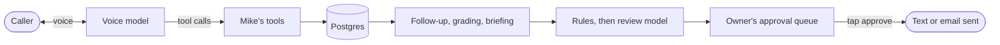

# ai-employee

An open-source AI employee. Mike answers the phone, books the visit, writes the follow-up text and
the morning briefing, and nothing reaches a customer until the owner taps approve.

This is the infrastructure behind an AI employee running in production at owner-operated home
services businesses, rebuilt on a synthetic sample business, **Brightwater Plumbing**, so anyone can
read it, run it and build on it. It is SOC 2 ready: the controls an audit looks for are built in,
mapped to the criteria and proven by tests.

## What it does

- **Answers calls in the browser.** A voice agent with three tools in real code: check openings, book a visit, finish the call. The voice model never touches the database directly.
- **Writes, then waits.** After a call, Mike drafts the follow-up text. Code rules check it first (no prices, promises, pressure or links), then a review model, then it waits for the owner.
- **Runs the day.** A team app for phones: Today, Texts, Calls and one-tap approvals. A daily briefing for the team, approved by the owner before it is sent.
- **Grades itself.** Every call that ends with a transcript is graded on whether the details are complete, the urgency is right and the rules were followed. A grader failure shows as needing a look, never as passed.

## How it fits together



- `src/agent/`: Mike's instructions, tools, call tokens and limits
- `src/review/`: the rules, the review model and the approval queue
- `src/jobs/`: follow-up, grading, the daily briefing, retention and customer deletion
- `src/app/`: the call page, the team app and the API routes
- `src/db/` and `db/migrations/`: roles, row-level security, field encryption and the audit log
- `src/providers/`: voice, language model, SMS and email behind one interface, with fakes for tests
- `docs/compliance/`: the SOC 2 readiness pack

## Quick start

Needs [Bun](https://bun.sh). Runs locally with no keys: the database is in-process and every outside
service is faked.

```sh
bun install
cp .env.example .env.local
# set SESSION_SECRET in .env.local, for example: openssl rand -base64 32
bun run db:seed
bun dev
```

Open http://localhost:3000, choose **Team app sign in** and enter `sam@brightwater.example` (the
owner). In local mode the sign-in link opens straight away instead of being emailed. You will find
Mike's reply to Dana Cole waiting for approval.

To talk to Mike out loud, set `PROVIDERS=live` and `OPENAI_API_KEY` in `.env.local`. Texts stay fake
unless `SMS_LIVE=1`, so nothing reaches a real phone by accident.

## Tests

```sh
bun test
```

Over a hundred tests, no keys needed: the tools, the review rules, sign-in, row-level security, the
audit chain, encryption, retention, a backup and restore, and red-team cases (a caller fishing for a
neighbor's details, a draft that tries to talk the reviewer into passing it).

`evals/brightwater/` is a [voice-ci](https://github.com/erickcxc/voice-ci) suite: AI callers phone
Mike over the real voice model, including a sales pitch posing as a customer, a burst pipe and a
caller trying "admin mode". It runs this repo's real tools on every call. See `evals/README.md`.

## SOC 2 ready

SOC 2 is an auditor's report on a company, so no codebase can pass one on its own. What this repo
gives a company is the technical controls built in and the evidence to show them:

- Forced row-level security on every table, least-privilege roles, and an agent that can delete nothing
- Contact details encrypted at rest, looked up by keyed hash
- An append-only, hash-chained audit log
- One-time sign-in links, revocable sessions, signed per-call tokens, rate limits
- A human approval gate on everything a customer sees
- Scheduled deletion and full customer deletion
- A tested backup and restore
- Secret scanning, dependency audit and static analysis in CI

Start at `docs/compliance/README.md`. The controls matrix (`docs/compliance/controls.md`) maps each
criterion to the code and the test that proves it, and CI fails if any of those references breaks.

## Deploying

Any Postgres and any Node host. Set `PROVIDERS=live` and the keys in `.env.example`: the app refuses
to start with fake services against a real database, and live mode refuses to start without the
model key. Email and texts stay fake until their keys (and `SMS_LIVE=1`) are set.

1. Run `bun run db:migrate` with `DATABASE_URL` set to an admin connection.
2. Create the app's login and give it `app_runtime` only: `create role ai_employee_app login password '...'; grant app_runtime to ai_employee_app;`
3. Run the app with `DATABASE_URL` set to that login.

`vercel.json` schedules the daily job (set `CRON_SECRET`). It writes the newest audit row's hash to
the host's logs every day; keep those logs, they are what the audit chain is checked against.

## License

MIT. See `LICENSE`. Security reports: `SECURITY.md`.
