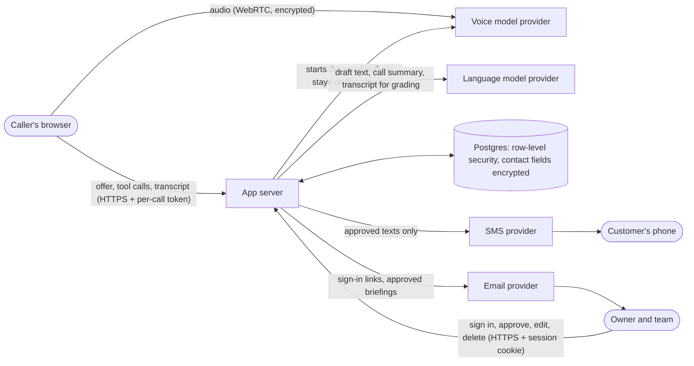

# Data inventory and data flow

What the AI employee collects, where it lives, who can read it and how long it is kept. SOC 2 C1.1
and C1.2. `src/compliance/docs.test.ts` fails if a table in `db/migrations/` is missing from this
page, or if a retention period here stops matching `src/compliance/retention.ts`.

## Data flow

What crosses each line:
- **Caller to voice provider:** the caller's voice, live. This app never records or stores audio.
- **Caller to app:** the tool calls Mike makes (opening times, a booking, the call record) and, when the call ends, the text transcript.
- **App to language model:** text only: a draft to review, a call summary to write a follow-up from, a transcript to grade. Every request is sent with the provider's do-not-store flag (`src/providers/index.ts`).
- **App to SMS and email:** only what the owner approved, plus sign-in links.

## Data at rest

Sensitivity: **Restricted** (contact details, conversation content), **Confidential** (business
records), **Internal** (operational).

| Table | What it holds | Sensitivity | Protection | Who can read | Kept for |
|---|---|---|---|---|---|
| `businesses` | Name and time zone | Internal | Row-level security | Everyone in that business | Life of the account |
| `people` | Owner and team: name, role, email | Restricted (email) | Email encrypted (AES-256-GCM); a keyed hash for sign-in lookups | Owner, team and agent (email only as ciphertext); sign-in role (id, role, hash) | Until removed by the owner |
| `customers` | Name, phone, email, address | Restricted | Phone, email and address encrypted; keyed phone hash for matching | Owner, team (contact fields only as ciphertext; views show names), agent (to match a caller) | Until the owner deletes the customer |
| `jobs` | What the work is, status, urgency, notes | Confidential | Row-level security | Owner, team, agent | Until the customer is deleted |
| `slots` | The calendar: open, held, booked times | Internal | Row-level security | Owner, team, agent | Until removed by the owner |
| `calls` | Outcome, summary, urgency, grade, transcript | Restricted (transcript) | Row-level security; transcript cleared on schedule | Owner, team, agent (writes the call), system role (clears transcripts) | Transcript: 90 days. Call record: until the customer is deleted |
| `messages` | Texts sent and received | Restricted | Row-level security | Owner, team | Until the customer is deleted |
| `drafts` | Texts and briefings waiting for approval, with their review | Confidential | Row-level security; agent can only insert pending | Owner (decides), team (reads) | Until the customer is deleted |
| `files` | File names and storage keys for job photos and documents | Confidential | Row-level security | Owner, team | Until the customer is deleted |
| `login_tokens` | Hash of each one-time sign-in link | Restricted | Only the hash is stored; sign-in role only | Sign-in role | 1 day after it expires |
| `sessions` | Who is signed in, until when | Internal | Server-side; revocable; sign-in role and owner only | Owner, sign-in role | 30 days after it ends |
| `audit_log` | Who did what, when, to which row (never message content) | Confidential | Append-only, hash-chained, owner-read-only | Owner | Not pruned by the app. Set by the company's retention policy (at least one year recommended) |
| `schema_migrations` | Which migrations ran | Internal | Admin only | Admin | Life of the database |

## Not stored

- Call audio. It goes between the caller and the voice provider and is never written here.
- Model keys, SMS and email keys. They live in the host's secret store and are read from the environment (`.env.example` lists the names).
- Plain sign-in links. Only their hash.
- Payment details. Nothing in this app takes payment.

## Deleting a customer

The owner can delete a customer from the team app. That removes the customer, their jobs, calls,
messages, drafts, file records and every briefing that names them, and frees their calendar slots,
in one transaction. The audit log
keeps a row for each deletion with the actor and the time, not the content
(`src/jobs/index.ts`, tested in `src/jobs/jobs.test.ts` "the owner can delete a customer everywhere; the audit log keeps that it happened, not what was said").
